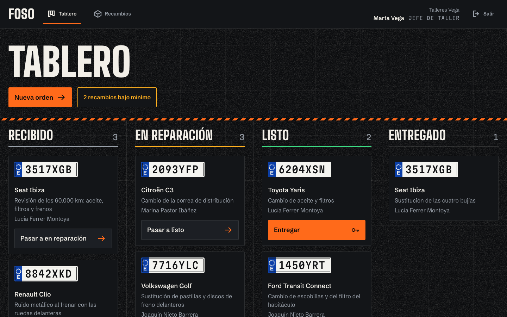

# FOSO

Gestión de un taller mecánico: las órdenes de trabajo en un tablero de cuatro columnas, los recambios con su stock, el presupuesto y la factura en PDF y el aviso al cliente por WhatsApp. Varios talleres aislados entre sí y dos roles, jefe y mecánico.

Es la entrega de una prueba técnica de desarrollo full stack con IA: una app Next.js construida por tres agentes de Claude Code que viven en este repo. Cada revisión queda registrada en `proceso/` y la app la enseña en `/proceso`.



> Aviso: datos ficticios. Talleres, clientes, matrículas, teléfonos y NIF son inventados y el PDF lleva la leyenda «Documento de demostración sin validez fiscal». Las puertas de calidad de `scripts/puertas` son trabajo propio reutilizado de otros proyectos, copiado tal cual.

## Probarla

https://foso-taller.vercel.app

| Correo                        | Rol      | Taller          | Contraseña          |
| ----------------------------- | -------- | --------------- | ------------------- |
| `jefe@tallerdemo.example`     | jefe     | Talleres Vega   | `{{DEMO_PASSWORD}}` |
| `mecanico@tallerdemo.example` | mecánico | Talleres Vega   | `{{DEMO_PASSWORD}}` |
| `jefe@otrotaller.example`     | jefe     | Mecánica Ribera | `{{DEMO_PASSWORD}}` |

En `/login`, «Entrar como jefe» y «Entrar como mecánico» entran sin escribir nada; el jefe del otro taller entra tecleando correo y contraseña. Dos minutos:

1. Como jefe, el tablero reparte las órdenes en Recibido, En reparación, Listo y Entregado. El botón grande de cada tarjeta la avanza de columna.
2. Abre una orden: «Descargar presupuesto» (PDF), «Avisar por WhatsApp» (abre `wa.me` con el mensaje; no envía nada) y, en una orden Listo, «Entregar», que numera la factura `F-AAAA-NNNN` y descuenta el stock.
3. En `/recambios`, los que están bajo mínimo salen arriba, en ámbar.
4. Como mecánico, «Entregar» no aparece y no se pueden crear ni cambiar recambios.
5. Como jefe de Mecánica Ribera no sale ni una matrícula de Talleres Vega: el aislamiento lo impone Postgres, no la interfaz.
6. Sin sesión, `/proceso` enseña las rondas reales de Develop y Testing.

## Los tres agentes

| Papel       | Archivo                                        | Qué hace                                                                                                                        |
| ----------- | ---------------------------------------------- | ------------------------------------------------------------------------------------------------------------------------------- |
| Orquestador | `CLAUDE.md`                                    | Reparte el trabajo, integra en `main` y lleva `proceso/features.json`. No programa                                              |
| Develop     | `.claude/agents/develop.md`                    | Escribe los tests, los ve fallar e implementa. Entrega un informe VERIFICADO / ABIERTO / SIN COMPROBAR                          |
| Testing     | `.claude/agents/testing.md` y `DIRECTRICES.md` | Revisa sin ver lo que dijo Develop: lee el diff y las directrices, corre los comandos, busca el caso que rompe. No edita código |

Develop y Testing se lanzaron como subagentes de Claude Code a los que se les dijo que leyeran `.claude/agents/develop.md` o `.claude/agents/testing.md`; esos archivos son su contrato.

El protocolo de ronda, para cada feature:

1. Encargo: el orquestador lanza a Develop con el bloque del paso; tests primero, `npm run check` en verde y commit.
2. Revisión: Testing, sin nada de lo que dijo Develop, revisa el diff contra `DIRECTRICES.md`, corre `npm run check:full` y escribe `proceso/<feature>/ronda-<N>.json`.
3. Vuelta: con veredicto `FALLA`, Develop recibe solo ese archivo, arregla con test primero y se vuelve al punto 2.
4. Cierre: con `PASA`, la rama entra en `main` y la feature queda `hecha`.
5. Tope: a la quinta ronda sin `PASA` se para y se devuelve el caso al arquitecto.

## Dónde están las rondas

- `proceso/<feature>/ronda-<N>.json`: el informe de cada ronda, tal como lo escribió Testing. No se editan después.
- `proceso/features.json`: las doce features del plan y su estado.
- `/proceso`: esas mismas rondas en la app, con veredicto, directriz incumplida, evidencia y commit.
- El historial de git: los commits `test(<feature>): ronda N` de Testing y `fix(<feature>): … [ronda N]` de Develop.

## Directrices con test

`DIRECTRICES.md` fija las quince reglas (D-1 a D-15) que Develop cumple y Testing comprueba: capas y dependencias, validación con zod, RLS en toda tabla, dinero en céntimos, límites de tamaño, tokens de diseño, contraste AA, estados de carga, error y vacío, y móvil a 390 px.

Ninguna es solo texto: cada una tiene al menos un test con su ID en el nombre (`[D-1]`…). `npm run spec:check` cruza `docs/SPEC.md` y `DIRECTRICES.md` con el informe de vitest y escribe el estado de cada criterio al final de ambos archivos. Solo D-13 pide navegador (`npm run gate:e2e`).

## Stack

- Next.js 16 con App Router, React 19 y TypeScript.
- Supabase (Postgres, Auth y RLS), solo desde el servidor; zod valida cada dato que entra.
- PDF con `pdf-lib`; Tailwind 4 con tokens propios en `src/ui/tokens.css`.
- Pruebas: Vitest, fast-check y PGlite (Postgres en proceso); Playwright con axe; Stryker sobre el núcleo.
- Puertas: ESLint, dependency-cruiser, knip, jscpd, gitleaks y un gate de GitHub Actions. Despliegue en Vercel.

## Arquitectura

```
navegador
   │  (solo HTML y acciones de servidor; el navegador nunca habla con Supabase)
   ▼
src/app/**            rutas, páginas de servidor y acciones finas
   │
   ├──► src/ui/**            componentes de presentación + tokens (sin datos, sin Supabase)
   │
   ▼
src/aplicacion/**     casos de uso: validan la entrada, piden al núcleo que decida, llaman a adaptadores
   │                     │
   ▼                     ▼
src/nucleo/**         src/adaptadores/**     supabase (repositorios), pdf, proceso (lee rondas del disco)
(puro, sin IO)                │
                              ▼
                     Supabase: Postgres + Auth + RLS      proceso/**/ronda-*.json
                     supabase/migrations/*.sql
```

Lo que cada capa no puede importar lo impone `.dependency-cruiser.cjs` (test `[D-1]`). El aislamiento entre talleres y los roles los decide Postgres, con RLS y funciones en `supabase/migrations`.

## Arrancar en local

```
nvm use                                                     # Node 24, el de .nvmrc
npm ci
git config core.hooksPath .githooks                         # opcional: activa el hook de commit
cp .env.example .env.local                                  # SUPABASE_URL, SUPABASE_PUBLISHABLE_KEY, SUPABASE_SECRET_KEY, CRON_SECRET, DEMO_PASSWORD
node --env-file=.env.local scripts/crear-usuarios-demo.mjs  # los tres usuarios y los datos de la demo
npm run dev
```

La base de datos sale de `supabase/migrations`: con Docker, `supabase start` y `supabase db reset` la levantan en local y `supabase status -o env` da sus claves. `npm run check` (lint, tipos y tests) es lo que corre el hook de commit (`.githooks/pre-commit`); `npm run check:full` suma cobertura, arquitectura, puertas y `spec:check`; `npm run gate:mutacion` muta el núcleo.

## Qué no hace

- Sin IA dentro de la app ni servicios de pago; sin registro público: los usuarios son los de la demostración.
- Sin pantallas de clientes y vehículos (se crean dentro de «Nueva orden»), sin arrastrar y soltar (la orden avanza con un botón), sin agenda, informes, exportaciones, modo sin conexión ni varios idiomas.
- La factura no tiene validez fiscal. WhatsApp solo abre `wa.me` con el mensaje escrito; no envía.
- No registra la causa de los fallos esperados: la regla `no-console` está activa y relajarla exige una línea `UMBRAL:` autorizada en el SPEC. En el cron, el PDF y «Restablecer la demo» solo se cuentan con un motivo en español los fallos esperados (errores de Supabase con código y de validación); los demás los relanzan y los registra Vercel. Las acciones que escriben (tablero, orden, nueva orden y recambios) capturan cualquier fallo y lo cuentan con un motivo en español, sin registrarlo.
- «Restablecer la demo» es público (cualquiera puede reiniciarla, como mucho una vez cada 10 minutos); los listados no se paginan.
- El PDF usa la fuente estándar Helvetica: una letra fuera de Latin-1 (cirílico, `ł`) sale como «?».

## Las cuatro preguntas

1. Pendiente: se contestan al recibirlas.
2. Pendiente: se contestan al recibirlas.
3. Pendiente: se contestan al recibirlas.
4. Pendiente: se contestan al recibirlas.
